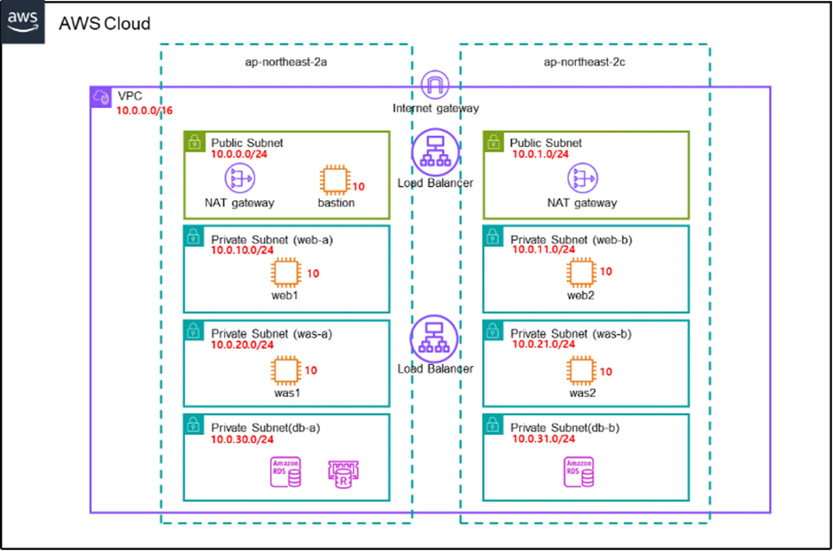

# 5.4 AWS EC2 기반 3계층(Web-WAS-DB) 구성

구성도의 모든 리소스(네트워크, 보안 그룹, EC2, 로드 밸런서 2개, RDS, ElastiCache, 내부 DNS)를 테라폼으로 만든다.



그림 5-4. AWS 실습 목표 아키텍처

요청 흐름은 다음과 같다.

```txt
사용자 ─ http://<web-lb DNS>
   │
   ▼
ALB web-lb (인터넷 경계, public-subnet-a/b) ── web-tg (HTTP:80, /healthz)
   │
   ▼
web1 10.0.10.10 / web2 10.0.11.10      NGINX :80 → was.cloud.local:5000
   │
   ▼
NLB was-lb (내부, was-subnet-a/b, TCP:5000) ── was-tg
   │
   ▼
was1 10.0.20.10 / was2 10.0.21.10      Flask :5000
   ├──▶ db.cloud.local     → RDS MySQL :3306 (db-subnet-a 기본 / db-subnet-b 대기)
   └──▶ redis.cloud.local  → ElastiCache Redis OSS :6379 (db-subnet-a, TLS)

관리 접속: 내 PC ─SSH─▶ bastion 10.0.0.10 (public-subnet-a) ─SSH(ProxyJump)─▶ 프라이빗 서버
```

파일은 학습자료(05장_State) 5.4절의 순서대로 나눴다. 각 파일의 주석에 콘솔 설정 항목을 적어 두었다.

| 학습자료 | 구성도 요소 | 테라폼 리소스 | 파일 |
| --- | --- | --- | --- |
| 5.4.2 | VPC, IGW, 서브넷 8개, NAT 게이트웨이 2개, 라우팅 | `aws_vpc.mynet`, `aws_subnet.this`, `aws_nat_gateway.nat` … | network.tf |
| 5.4.2 | 계층별 보안 그룹 7개 | `aws_security_group.*` | security.tf |
| 5.4.2 | bastion, web1·web2, was1·was2 (IP 끝자리 .10) | `aws_instance.bastion`, `aws_instance.server` | ec2.tf |
| 5.4.5 ~ 5.4.7 | 내부 DNS `cloud.local` | `aws_route53_zone.private` | dns.tf |
| 5.4.5 | RDS (db-a 기본, db-b 대기) + `db.cloud.local` | `aws_db_instance.mysql` (보안 그룹 default, mysql-sg) | rds.tf |
| 5.4.6 | ElastiCache Redis (db-a) + `redis.cloud.local` | `aws_elasticache_replication_group.redis` (보안 그룹 default, redis-sg, 자동 백업 해제) | elasticache.tf |
| 5.4.7 6~7 | Load Balancer (아래, 내부) + `was.cloud.local` | `aws_lb.was` (NLB, TCP:5000) + `was-tg` (TCP 상태 검사) | was_lb.tf |
| 5.4.8 3 | Load Balancer (위, 외부) | `aws_lb.web` (ALB, HTTP:80, 보안 그룹 default, web-lb-sg) + `web-tg` (`/healthz`) | web_lb.tf |

대상 그룹의 상태 검사 임계값(정상 5회, 비정상 2회, 간격 30초)은 콘솔 기본값과 같게 명시했다.

## 실행

사전 준비: AWS CLI 자격 증명, 키 페어 `mykey`(4-2-4 참고).

```bash
cd ch05/5.4
cp terraform.tfvars.example terraform.tfvars   # admin_cidr, db_password 수정
terraform init
terraform plan
terraform apply -auto-approve                   # RDS Multi-AZ 때문에 약 15분
terraform output
```

테라폼은 인프라까지만 만든다. 서버 안의 애플리케이션은 학습자료 순서대로 직접 구성한다.

- 데이터베이스와 사용자 생성: 5.4.5 3 (`mysql -h db.cloud.local -u root -p`)
- WAS(Flask) 설치와 서비스 등록: 5.4.7 1 ~ 5
- Web(NGINX) 설치와 프록시 설정: 5.4.8 1 ~ 2

학습자료의 콘솔 단계(5.4.5 1~2, 5.4.6, 5.4.7 6~7, 5.4.8 3)는 테라폼이 이미 만들었으므로 건너뛴다.

애플리케이션을 설치하기 전에는 대상 그룹의 상태 검사가 `unhealthy`로 나온다. was-tg는 Flask가 5000번 포트로 뜨면, web-tg는 NGINX가 `/healthz`를 WAS로 프록시해 200을 받으면 `healthy`로 바뀐다.

## 삭제

모든 리소스가 State에 있으므로 한 번에 삭제된다.

```bash
terraform destroy -auto-approve
```

> **비용 주의**: NAT 게이트웨이 2개, ALB·NLB, RDS Multi-AZ, ElastiCache가 시간당 과금된다. 실습이 끝나면 바로 삭제한다. 비용을 줄이려면 `terraform.tfvars`에 `db_multi_az = false`를 넣는다.
