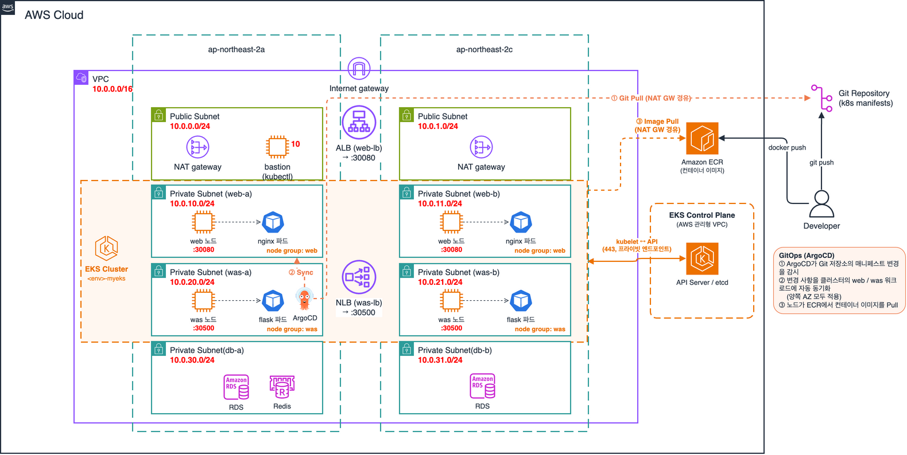

# 5.6 AWS EKS + Argo CD 기반 3계층(Web-WAS-DB) 구성

5.4(EC2 기반)와 같은 요청 흐름을 유지하면서 web·was 서버를 **Amazon EKS 관리형 노드 그룹**으로 바꾸고, 애플리케이션 배포는 **Argo CD(GitOps)** 로 한다. 테라폼은 인프라와 Argo CD까지만 만들고, web·was 앱은 Git 저장소의 매니페스트(`gitops/`)를 Argo CD가 클러스터에 동기화한다. web·was 컨테이너 이미지는 **Amazon ECR**(`<env>-web`, `<env>-was`)에 두고 노드가 ECR에서 내려받는다.

같은 코드를 **dev, stg, prod 환경별로** 배포할 수 있다. 환경마다 State를 워크스페이스로 따로 두고, 계정 안에서 고유해야 하는 이름에 `<env>-` 접두사를 붙인다([환경 구분](#환경-구분-dev--stg--prod) 참고). 별도의 사전 인프라(State 버킷, 배포 사용자·역할) 없이 AWS 자격 증명만 있으면 실행할 수 있다.



그림 5-6. 실습 구성도 (EKS 클러스터: web·was 노드 그룹, Argo CD가 Git 저장소의 매니페스트를 web·was에 동기화, 노드는 Amazon ECR에서 컨테이너 이미지를 내려받음)

요청 흐름은 다음과 같다. 5.4와 달라진 부분은 서버가 노드 그룹이 되고 대상 그룹이 노드의 NodePort로 보낸다는 점뿐이다.

```txt
사용자 ─ http://<web-lb DNS>          (실제 이름은 dev-web-lb, dev-web-tg처럼 <env>- 접두사가 붙는다)
   │
   ▼
ALB web-lb (인터넷 경계, public-subnet-a/b) ── web-tg (HTTP:30080, /healthz)
   │
   ▼
web 노드 그룹 (web-subnet-a/b, web-sg) :30080 → web(nginx) 파드 2개 (이미지: ECR <env>-web)  NGINX :80 → was.cloud.local:5000
   │
   ▼
NLB was-lb (내부, was-subnet-a/b, TCP:5000) ── was-tg (TCP:30500)
   │
   ▼
was 노드 그룹 (was-subnet-a/b, was-sg) :30500 → was(flask) 파드 2개 (이미지: ECR <env>-was)  Flask :5000
   ├──▶ db.cloud.local     → RDS MySQL :3306 (db-subnet-a 기본 / db-subnet-b 대기)
   └──▶ redis.cloud.local  → ElastiCache Redis OSS :6379 (db-subnet-a, TLS)
```

배포 흐름(GitOps)과 관리 접속:

```txt
Developer ─git push─▶ Git Repository (gitops/: web·was 매니페스트)
                            ▲
                            │ ① Git Pull (was 노드 → NAT 게이트웨이 → IGW)
Argo CD (argocd 네임스페이스, was-subnet-a의 was 노드)
   └─ ② Sync (자동, prune·selfHeal) ─▶ web·was Deployment / Service (양쪽 AZ)

Developer ─docker push─▶ Amazon ECR <env>-web, <env>-was (리전 서비스, VPC 밖)   scripts/push-images.sh
                            ▲
                            │ ③ Image Pull (web·was 노드 → NAT 게이트웨이 → IGW)
web·was 노드 (kubelet) ─────┘   노드 IAM 역할의 AmazonEC2ContainerRegistryReadOnly로 인증

노드 kubelet ─443─▶ EKS API 프라이빗 엔드포인트 (컨트롤 플레인은 AWS 관리형 VPC)
내 PC ─SSH─▶ bastion 10.0.0.10 (public-subnet-a) ─kubectl─▶ EKS API (프라이빗 엔드포인트)
                                              └SSH(ProxyJump)─▶ 노드
```

## 구성도와 코드

| 구성도 | 코드 | 파일 |
| --- | --- | --- |
| VPC 10.0.0.0/16, AZ 2a·2c, 서브넷 8개 (public·web·was·db × a/b) | `local.subnets` | network.tf |
| Internet gateway, NAT gateway × 2 (public-subnet-a/b) | AZ마다 NAT, 프라이빗 라우팅 테이블 `private-rt-a/b` | network.tf |
| bastion (kubectl) 10.0.0.10 | kubectl·kubeconfig 설치, EKS 액세스 항목(클러스터 관리자) | bastion.tf, iam.tf, eks.tf |
| EKS Cluster `<env>-myeks` | 컨트롤 플레인 ENI는 web/was 서브넷, 엔드포인트 프라이빗+퍼블릭(`admin_cidr`) | eks.tf, iam.tf |
| node group: web (web-a/b, :30080) | `aws_eks_node_group.this["web"]` 노드 2대, web-sg, 레이블 `tier=web` | eks.tf, security.tf |
| node group: was (was-a/b, :30500) | `aws_eks_node_group.this["was"]` 노드 2대, was-sg, 레이블 `tier=was` | eks.tf, security.tf |
| ALB (web-lb) → :30080 | web-tg 대상은 web 노드 그룹의 ASG | web_lb.tf |
| NLB (was-lb) → :30500 | was-tg 대상은 was 노드 그룹의 ASG, `was.cloud.local` | was_lb.tf |
| RDS (db-a 기본 / db-b 대기) | `db_multi_az = true`(기본), `db.cloud.local` | rds.tf |
| Redis (db-a) | ElastiCache Redis OSS, TLS, `redis.cloud.local` | elasticache.tf |
| - | Route 53 프라이빗 영역 `cloud.local` | dns.tf |
| ArgoCD (was-a) | Helm 차트 `argo-cd`. 모든 파드를 `tier=was` + AZ a 노드에 배치. dex·notifications 끔 | argocd.tf |
| ① Git Pull (NAT GW 경유) | 노드의 기존 경로(프라이빗 서브넷 → NAT → IGW). 보안 그룹·라우팅 추가 없음 | - |
| ② Sync | Helm 차트 `argocd-apps`로 Application `web-was` 생성. 자동 동기화(`prune`, `selfHeal`) | argocd.tf |
| Amazon ECR | 리포지토리 `<env>-web`, `<env>-was` (태그 변경 불가, push 시 스캔, 수명 주기 정책). 첫 apply 때 이미지 빌드·push | ecr.tf, app/, scripts/push-images.sh |
| docker push | app/<앱>/Dockerfile을 linux/amd64로 빌드해 push. 태그는 gitops/<앱>.yaml의 `image: <앱>:<태그>` | scripts/push-images.sh |
| ③ Image Pull (NAT GW 경유) | 노드 역할의 `AmazonEC2ContainerRegistryReadOnly`로 인증(`imagePullSecrets` 불필요). Application이 kustomize `images`로 이름 `web`·`was`를 ECR 주소로 바꾼다 | iam.tf, argocd.tf |
| Git Repository (k8s manifests) | nginx·flask Deployment / Service, NGINX 설정(kustomize) | gitops/ |
| - | DB·사용자·테이블 생성 Job `db-init` (암호를 Git에 올리지 않도록 테라폼이 관리) | db_init.tf |

테라폼과 Argo CD는 같은 리소스를 함께 관리하지 않는다.

- **테라폼**: 인프라(ECR 포함) + Argo CD 설치·Application + Secret·Job `db-init` + 첫 이미지 push
- **Argo CD**: web·was Deployment / Service, ConfigMap `web-nginx-<해시>` (gitops/)

설계 메모

- **로드 밸런서는 5.4처럼 테라폼이 만든다.** AWS Load Balancer Controller를 쓰지 않으므로 State 밖에서 생기는 AWS 리소스가 없고, `terraform destroy` 한 번으로 모두 지워진다.
- **NodePort는 테라폼 변수가 기준이다.** 대상 그룹 포트·보안 그룹과 맞물리므로 Application의 kustomize 패치로 `web_node_port`(30080)·`was_node_port`(30500)를 gitops/ Service에 덮어쓴다.
- **노드에 계층 보안 그룹을 붙인다.** 시작 템플릿으로 노드에 `[클러스터 보안 그룹, web-sg | was-sg]`를 지정한다. VPC CNI는 파드 IP를 노드 ENI에 할당하므로 was 파드의 트래픽도 was-sg로 식별되어 mysql-sg·redis-sg 규칙(소스 was-sg, bastion-sg)이 5.4와 똑같이 적용된다.
- **파드도 `*.cloud.local`을 그대로 쓴다.** CoreDNS가 VPC DNS로 전달하므로 Route 53 프라이빗 호스팅 영역이 조회된다. 학습자료의 Flask 앱(mywas2)과 NGINX 설정을 고치지 않고 사용한다.
- 노드 IP는 서브넷에서 자동 할당된다(5.4의 고정 IP `.10`은 노드 그룹에서 지정할 수 없다).
- **컨테이너 이미지는 ECR에 둔다.** was 이미지(app/was/Dockerfile)에 Flask 패키지와 앱 소스(mywas2, 커밋 고정)를 미리 넣어 두었다. 예전처럼 파드가 뜰 때마다 pip install·git clone을 하지 않으므로 바로 시작한다. web 이미지는 `nginx:1.28` 그대로이고, NGINX 설정은 ConfigMap(gitops/default.conf)으로 넣는다.
- **ECR 주소는 Git에 적지 않는다.** 주소(`<계정 ID>.dkr.ecr.<리전>.amazonaws.com/<env>-web`)는 계정·환경마다 다르다. gitops/에는 `image: web:1.0.0`처럼 이름과 태그만 적고, Application의 kustomize `images`가 이름을 ECR 주소로 바꾼다. 태그는 Git 값이 그대로 쓰이므로 배포는 여전히 GitOps(태그 변경 → push)로 한다.
- **태그는 바꿀 수 없다(IMMUTABLE).** 같은 태그로 다른 이미지를 덮어쓰면 Argo CD가 변경을 알 수 없으므로 막아 둔다. 앱을 바꾸면 반드시 태그를 올린다.
- 이미지 Pull은 NAT 게이트웨이를 거친다. 트래픽이 많으면 ECR VPC 엔드포인트(`ecr.api`, `ecr.dkr`, S3 게이트웨이)를 두어 NAT 비용을 줄일 수 있다.

## 환경 구분 (dev · stg · prod)

한 AWS 계정 안에서 `var.env`로 환경을 나눈다.

| 항목 | 내용 | 파일 |
| --- | --- | --- |
| `env` | `dev`(기본) / `stg` / `prod`. 그 밖의 값은 validation 오류 | variables.tf |
| 이름 접두사 | 계정(리전)에서 고유해야 하는 이름에만 붙인다 | env.tf 외 |
| `Environment` 태그 | 모든 리소스에 `Environment = <env>` (default_tags, 노드 시작 템플릿) | versions.tf, eks.tf |
| State | 로컬. 워크스페이스 `<env>`를 쓰면 `terraform.tfstate.d/<env>/terraform.tfstate` | versions.tf |

이름이 바뀌는 리소스 (`env = dev`일 때):

| 리소스 | 이름 |
| --- | --- |
| EKS 클러스터 | `dev-myeks` |
| IAM 역할·인스턴스 프로파일 | `dev-myeks-cluster-role`, `dev-myeks-node-role`, `dev-myeks-bastion-role`, `dev-myeks-bastion-profile` |
| 시작 템플릿 | `dev-web-node`, `dev-was-node` |
| RDS (서브넷 그룹·식별자) | `dev-mysql` |
| ElastiCache (서브넷 그룹·복제 그룹) | `dev-redis` |
| 로드 밸런서·대상 그룹 | `dev-web-lb`, `dev-web-tg`, `dev-was-lb`, `dev-was-tg` |
| ECR 리포지토리 | `dev-web`, `dev-was` |

VPC(`mynet`), 서브넷, 보안 그룹, Route 53 프라이빗 영역(`cloud.local`), 쿠버네티스 리소스는 환경마다 별도 VPC·클러스터에 생기므로 이름을 바꾸지 않았다. 콘솔에서는 `Environment` 태그로 구분한다. 서브넷 CIDR(10.0.0.0/16)과 bastion IP(10.0.0.10)도 환경마다 같다(VPC 간 연결이 없으므로 겹쳐도 된다).

## 실행

사전 준비

- AWS CLI 자격 증명: VPC·EKS·IAM·RDS·ElastiCache·ELB·Route 53·ECR을 만들 수 있는 권한(예: 관리자). 실습 PC에 aws CLI가 있어야 한다(helm·kubernetes 프로바이더가 `aws eks get-token`으로 인증).
- **Docker**(buildx 포함)가 실행 중이어야 한다. `terraform apply`가 web·was 이미지를 빌드해 ECR에 push한다. Apple Silicon Mac에서도 노드에 맞게 linux/amd64로 빌드한다(was 이미지 첫 빌드는 에뮬레이션 때문에 몇 분 걸린다).
- 키 페어 `mykey`(5.4.2 참고). 실습 PC에 kubectl은 없어도 된다(확인용으로만 사용).
- **gitops/ 디렉터리를 Git 저장소에 push**해 둔다. Argo CD는 `gitops_repo_url`(기본값 `https://github.com/kshelp/tf.git`)의 `gitops_repo_revision`(`main`) 브랜치, `gitops_repo_path`(`ch05/5.6/gitops`)를 읽는다. 다른 저장소를 쓰면 `terraform.tfvars`에 지정한다. 공개 저장소가 아니면 [주의할 점](#gitops-주의할-점)을 참고한다.

```bash
cd ch05/5.6
cp terraform.tfvars.example terraform.tfvars   # admin_cidr, db_password 수정

export TF_VAR_env=dev                           # dev | stg | prod (생략하면 dev)

terraform init
terraform workspace select -or-create $TF_VAR_env   # 환경별 State 분리 (한 환경만 쓰면 생략 가능)
terraform plan
terraform apply -auto-approve                   # 약 20~25분 (EKS 클러스터 ~10분, 노드 그룹, RDS, 이미지 빌드·push)
terraform output
```

**환경 바꾸기**: `TF_VAR_env`를 바꾸고 `terraform workspace select -or-create <env>`로 워크스페이스를 바꾼다. State가 워크스페이스마다 따로 있으므로 다른 환경의 리소스에 영향을 주지 않는다. `TF_VAR_env`와 워크스페이스 이름이 다르면 다른 환경의 이름으로 리소스를 만들게 되므로 둘을 항상 같이 바꾼다.

> **State 보관**: State는 실습 PC에만 있고 DB 암호 등 민감 정보가 평문으로 들어 있다(.gitignore로 커밋 제외). 이 파일을 잃으면 `terraform destroy`를 할 수 없으므로 리소스를 모두 지우기 전까지 지우지 않는다. 여러 사람·CI가 함께 쓰려면 원격 백엔드(S3 등)를 versions.tf에 추가한다.

> **EKS 접근 권한**: 클러스터를 만든 IAM 주체(`terraform apply`를 실행한 자격 증명)가 클러스터 관리자 권한을 받는다(`bootstrap_cluster_creator_admin_permissions`). 따라서 `kubectl`도 같은 자격 증명(`AWS_PROFILE`)으로 실행해야 한다. 다른 IAM 주체에도 권한을 주려면 eks.tf에 `aws_eks_access_entry`를 추가한다(bastion 역할이 그 예).

> `admin_cidr`는 bastion SSH와 **EKS API 퍼블릭 엔드포인트** 모두에 적용된다. 테라폼(kubernetes·helm 프로바이더)이 실습 PC에서 클러스터에 접속해 Argo CD와 db-init을 만들므로, 실습 PC의 공인 IP가 바뀌면 `admin_cidr`도 바꿔야 한다.

테라폼은 Job `db-init`이 완료되고 Argo CD 파드가 Ready가 된 뒤 Application을 만든다. web·was 파드는 그 뒤 Argo CD가 배포하므로 `apply`가 끝나고 1~2분 지나면 서비스가 동작한다. 테라폼은 ECR에 이미지를 push한 뒤에 Application을 만든다.

## 확인

```bash
# 1) 브라우저 또는 curl로 접속 → 로그인 화면 (5.4.7 3)
curl -s $(terraform output -raw web_url)/login | head
curl -s $(terraform output -raw web_url)/healthz      # OK

# 2) 대상 그룹 상태: 노드 2대씩 healthy
aws elbv2 describe-target-health --target-group-arn $(aws elbv2 describe-target-groups --names ${TF_VAR_env:-dev}-web-tg --query 'TargetGroups[0].TargetGroupArn' --output text)
aws elbv2 describe-target-health --target-group-arn $(aws elbv2 describe-target-groups --names ${TF_VAR_env:-dev}-was-tg --query 'TargetGroups[0].TargetGroupArn' --output text)

# 3) 클러스터 (실습 PC에 kubectl이 있거나 bastion에서)
# 실습 PC(Mac)에 kubectl 설치
brew install kubectl
kubectl version --client

$(terraform output -raw kubeconfig_command)
kubectl get nodes -L tier,topology.kubernetes.io/zone
kubectl get pods -o wide
kubectl get deploy web was -o jsonpath='{range .items[*]}{.spec.template.spec.containers[0].image}{"\n"}{end}'   # ECR 이미지
kubectl logs job/db-init

# 5) ECR
terraform output app_images
aws ecr describe-images --repository-name ${TF_VAR_env:-dev}-was --query 'imageDetails[].[imageTags[0],imagePushedAt]' --output table

# 4) Argo CD
kubectl -n argocd get pods -o wide                  # was-subnet-a(AZ a)의 was 노드에 배치
kubectl -n argocd get application                   # SYNC STATUS: Synced, HEALTH STATUS: Healthy
eval "$(terraform output -raw argocd_admin_password_command)"   # admin 초기 암호
eval "$(terraform output -raw argocd_port_forward_command)"     # https://localhost:8080 접속
```

브라우저에서 회원 가입(Register) → 로그인하면 대시보드에 처리한 was 파드 이름(Server Name)이 보인다. 새로 고침해도 로그인이 유지되면 Redis 세션 공유가 동작하는 것이다(5.4.10). was 파드 하나를 지워도(`kubectl delete pod <was 파드>`) 로그인이 유지된다.

bastion에서 확인 (5.4와 동일):

```bash
ssh -i ~/keys/mykey.pem ec2-user@$(terraform output -raw bastion_public_ip)
mysql -h db.cloud.local -u frodo -p -e "SELECT id, username FROM frodo.users;"
kubectl get pods -o wide        # bastion에도 kubeconfig가 설정되어 있다
```

## 어플리케이션 접속 테스트
```bash
cd ~/dev/workspace/tf/ch05/5.6
terraform output -raw web_url
# 예: http://dev-web-lb-1234567890.ap-northeast-2.elb.amazonaws.com

curl -s $(terraform output -raw web_url)/healthz      # OK
```


## 앱 변경 (GitOps)

앱은 `terraform apply` 없이 **gitops/를 고쳐 Git에 push**하면 바뀐다. Argo CD가 최대 `argocd_reconciliation_seconds`(120초) 안에 변경을 감지해 반영한다. 이 장은 애플리케이션 개발자가 따르는 설정과 개발 절차다.

### 역할 분담

| 담당 | 다루는 것 | 반영 방법 |
| --- | --- | --- |
| 인프라(테라폼) | VPC, EKS, ECR, RDS, LB, Argo CD 설치·Application, NodePort | `terraform apply` |
| **앱 개발자** | `app/<앱>/Dockerfile`, `gitops/*.yaml`, `gitops/default.conf` | **이미지 push + `git push`** |
| Argo CD | Git의 gitops/를 클러스터에 맞춤 | 자동 (최대 120초) |

앱 개발자는 `*.tf`와 `terraform apply`를 쓰지 않는다. 배포 수단은 **Git**과 **ECR** 두 가지다.

### 처음 한 번 하는 설정

**개발자 PC**

- git, Docker(buildx 포함), AWS CLI, kubectl(배포 결과 확인용)을 설치한다.
- Apple Silicon Mac이어도 이미지는 linux/amd64로 빌드해야 한다. `scripts/push-images.sh`가 알아서 처리한다.

**인프라 담당자에게 받을 권한**

1. **Git 저장소 쓰기 권한**: main에 merge할 수 있어야 한다. main 보호 규칙과 PR 리뷰를 함께 두는 것을 권장한다.
2. **ECR push 권한**: `scripts/setup-ecr-push-access.sh`로 준다. 인프라 담당자가 IAM 관리 권한이 있는 자격 증명으로 실행하면 IAM 그룹 `app-developers`와 정책 `app-developers-ecr-push`를 만들고 개발자를 그룹에 넣는다. 다시 실행해도 안전하다(정책은 새 버전으로 갱신).

   ```bash
   scripts/setup-ecr-push-access.sh -n                    # 정책 JSON만 확인 (AWS 변경 없음)
   scripts/setup-ecr-push-access.sh -u dev1 -u dev2       # dev·stg·prod × web·was에 push 허용
   scripts/setup-ecr-push-access.sh -e dev -a was -u dev1 # dev-was에만
   ```

   | 권한 | 쓰는 곳(push-images.sh) | 리소스 |
   | --- | --- | --- |
   | `sts:GetCallerIdentity` | 계정 ID 확인 | 권한 불필요(항상 허용) |
   | `ecr:GetAuthorizationToken` | `docker login` 토큰 | `*` (리소스 지정 불가) |
   | `ecr:DescribeImages` | 같은 태그가 이미 있는지 확인 | `<env>-<앱>` |
   | `ecr:BatchCheckLayerAvailability`, `InitiateLayerUpload`, `UploadLayerPart`, `CompleteLayerUpload` | 레이어 업로드 | `<env>-<앱>` |
   | `ecr:PutImage` | 매니페스트(태그) 등록 | `<env>-<앱>` |
   | `ecr:BatchGetImage`, `GetDownloadUrlForLayer` | buildx가 push 중 기존 매니페스트·레이어 조회 | `<env>-<앱>` |

   리포지토리 생성·삭제, 정책·수명 주기 변경은 주지 않는다(테라폼 ecr.tf 담당). 태그 변경 불가(`IMMUTABLE`)이므로 push 권한이 있어도 기존 태그를 덮어쓸 수 없다.

   **누가 실행하나**: IAM 정책·그룹을 만드는 스크립트이므로 IAM 관리 권한이 있는 인프라 담당자가 실행한다(예: `terraform apply`를 실행하는 관리자 자격 증명, 5.7의 user1). 개발자가 이 권한을 가지면 자기에게 어떤 권한이든 줄 수 있으므로, 권한을 **주는 사람**과 **쓰는 사람**을 나눈다. 5.7의 배포 역할 `tf-deployer-<env>`는 IAM 권한이 `<env>-*` 역할로 제한되어 있어 실행할 수 없다.

   **개발자 IAM 사용자 만들기** (인프라 담당자)

   `-u`에는 **IAM 사용자 이름**을 넣는다. 스크립트는 사용자를 만들지 않으므로 먼저 만든다.

   ```bash
   # ① 사용자 생성 (콘솔 로그인 없이 CLI용 액세스 키만 쓴다)
   aws iam create-user --user-name dev1 --tags Key=Role,Value=app-developer

   # ② 그룹 app-developers에 추가 → ECR push 권한 부여
   scripts/setup-ecr-push-access.sh -u dev1

   # ③ 액세스 키 발급 — SecretAccessKey는 이때 한 번만 표시된다
   aws iam create-access-key --user-name dev1 \
     --query 'AccessKey.[AccessKeyId,SecretAccessKey]' --output text
   ```

   액세스 키는 메신저·메일 평문이 아니라 비밀번호 관리자 등 안전한 경로로 개발자에게 전달한다.

   **개발자 PC 설정** (앱 개발자)

   ```bash
   aws configure --profile dev1          # 받은 키, 리전 ap-northeast-2
   export AWS_PROFILE=dev1

   aws sts get-caller-identity           # Arn이 ...:user/dev1 인지 확인
   aws ecr describe-images --repository-name dev-was \
     --query 'imageDetails[].imageTags[]' --output text   # 권한 확인 (AccessDenied가 아니면 OK)

   TF_VAR_env=dev scripts/push-images.sh was
   ```

   **사용자 정리** (퇴사·권한 회수)

   ```bash
   aws iam remove-user-from-group --group-name app-developers --user-name dev1   # 권한만 회수
   # 사용자까지 지울 때: 액세스 키를 먼저 지워야 한다
   for k in $(aws iam list-access-keys --user-name dev1 --query 'AccessKeyMetadata[].AccessKeyId' --output text); do
     aws iam delete-access-key --user-name dev1 --access-key-id "$k"
   done
   aws iam delete-user --user-name dev1
   ```

   IAM 그룹에는 IAM 사용자만 넣을 수 있다. 개발자가 다른 방식으로 로그인하면 `-u` 없이 실행해 정책만 만들고 아래처럼 연결한다.

   | 개발자 로그인 방식 | 권한 주는 방법 |
   | --- | --- |
   | IAM 사용자(액세스 키) | `scripts/setup-ecr-push-access.sh -u <사용자>` |
   | IAM 역할(AssumeRole) | `aws iam attach-role-policy --role-name <역할> --policy-arn arn:aws:iam::<계정 ID>:policy/app-developers-ecr-push` |
   | IAM Identity Center(SSO) | 권한 세트(permission set)에 같은 정책 내용을 넣어 할당 |

   > 실무에서는 오래 쓰는 액세스 키보다 IAM Identity Center(SSO)나 역할(임시 자격 증명)을 권장한다. 이 실습은 5.7과 같이 IAM 사용자로 진행한다.
3. **EKS 조회 권한**(상태 확인용): 지금 코드에서는 클러스터를 만든 주체와 bastion만 클러스터에 접근할 수 있다. 개발자도 보려면 eks.tf에 개발자용 `aws_eks_access_entry`를 추가하고 `AmazonEKSViewPolicy`(읽기 전용)를 연결한다. 쓰기 권한은 주지 않는다. 클러스터 변경은 Git으로만 한다.
4. **Argo CD UI 접속**(선택): admin 계정을 공유하기보다 읽기 전용 계정을 따로 만든다.

### 변경 종류별 절차

| 변경 내용 | 고치는 파일 | 이미지 빌드 | 태그 올리기 |
| --- | --- | --- | --- |
| NGINX 설정 | `gitops/default.conf` | ✗ | ✗ (ConfigMap 해시가 바뀌어 web 파드가 다시 만들어짐) |
| 레플리카 수, 리소스, 프로브, 환경 변수 | `gitops/<앱>.yaml` | ✗ | ✗ |
| was 앱 코드 | mywas2 저장소에 커밋 → `app/was/Dockerfile`의 `APP_COMMIT` | ✓ | ✓ |
| 베이스 이미지, 패키지 | `app/<앱>/Dockerfile` | ✓ | ✓ |
| NodePort, 이미지 이름(`web`, `was`) | **수정 금지** (테라폼이 덮어씀) | - | - |

**매니페스트만 바꾸는 경우** (예: web 파드를 3개로)

```bash
sed -i '' 's/replicas: 2 # web1, web2/replicas: 3/' gitops/web.yaml
git add gitops && git commit -m "web replicas 3" && git push
kubectl -n argocd get application -w               # OutOfSync → Synced
kubectl get pods -l app=web -o wide
```

### 앱 코드 변경 배포 (예: was 1.0.0 → 1.0.1)

```bash
cd ch05/5.6
git pull

# ① 코드 반영: 앱 저장소(mywas2)에 커밋한 뒤 그 커밋으로 바꾼다
sed -i '' 's/^ARG APP_COMMIT=.*/ARG APP_COMMIT=<새 커밋>/' app/was/Dockerfile

# ② 로컬 테스트 (PC 아키텍처 그대로 빌드)
docker build -t was:dev app/was
docker run --rm -p 5000:5000 was:dev      # DB·Redis가 없으므로 기동·import 정도만 확인

# ③ 태그 올리기 (이 값이 배포 버전이다)
sed -i '' 's/image: was:1.0.0/image: was:1.0.1/' gitops/was.yaml

# ④ ECR에 push — 반드시 git push보다 먼저
TF_VAR_env=dev scripts/push-images.sh was      # 빌드 → ECR dev-was:1.0.1
# 다른 환경도 운영 중이면 그 환경의 ECR에도 push (아래 "주의할 점" 참고)
# TF_VAR_env=stg  scripts/push-images.sh was
# TF_VAR_env=prod scripts/push-images.sh was

# ⑤ Git 반영 (PR → 리뷰 → main merge)
git checkout -b was-1.0.1
git add app/was gitops/was.yaml
git commit -m "was 1.0.1: <변경 내용>"
git push -u origin was-1.0.1
```

main에 merge되면 다음이 일어난다.

```txt
Argo CD (최대 120초 안에 감지) ─ OutOfSync → Sync
  └─ was Deployment 이미지가 …/dev-was:1.0.1로 바뀜 → 롤링 업데이트
     (새 파드가 /healthz Ready가 된 뒤 기존 파드 종료, AZ마다 하나씩)
```

확인:

```bash
kubectl -n argocd get application web-was          # Synced / Healthy
kubectl get pods -l app=was -w
kubectl get deploy was -o jsonpath='{.spec.template.spec.containers[0].image}'
curl -s $(terraform output -raw web_url)/healthz   # OK
```

**롤백**: Git 커밋을 되돌린다. 이전 태그의 이미지는 ECR에 남아 있다(최근 10개 보관).

```bash
git revert <커밋> && git push      # 태그가 1.0.0으로 돌아가고 Argo CD가 다시 배포
```

### GitOps 주의할 점

- **이미지를 먼저 push하고, 그다음 git push한다.** 순서가 바뀌면 새 파드가 `ImagePullBackOff`가 된다. 기존 파드는 계속 동작하므로 서비스는 멈추지 않지만 배포가 멈춘다.
- **태그는 매번 새로 쓴다.** ECR이 `IMMUTABLE`이라 같은 태그로는 push되지 않는다. 스크립트는 이 경우 건너뛰기만 하므로, 코드를 바꿨는데 배포되지 않으면 태그를 올렸는지 먼저 확인한다.
- **모든 환경이 같은 gitops/를 본다.** dev, stg, prod의 Argo CD가 모두 `main` 브랜치의 `ch05/5.6/gitops`를 읽으므로 main에 merge하는 순간 **세 환경에 동시에 배포**된다. 그래서 태그를 올리기 전에 운영 중인 모든 환경의 ECR에 push한다. `terraform apply`를 다시 해도 태그 변경을 감지해 그 환경의 ECR에 push한다. 환경별로 차례로 배포하려면 아래 "환경별 순차 배포"를 참고한다.
- **클러스터를 kubectl로 직접 고치지 않는다.** `kubectl scale deploy web --replicas=1`처럼 바꾸면 `selfHeal`이 Git 상태로 되돌린다. gitops/에서 리소스를 지우면 `prune`이 클러스터에서도 지운다.
- **먼저 push**: Application은 Git 저장소를 읽으므로 gitops/가 `gitops_repo_revision` 브랜치에 없으면 동기화가 실패한다(`kubectl -n argocd describe application web-was`로 확인).
- **이미지 이름**: gitops/의 `image: web:<태그>`, `image: was:<태그>`에서 이름 부분(web, was)은 Application이 ECR 주소로 바꾸므로 그대로 둔다. `push-images.sh`와 ecr.tf도 이 줄에서 태그를 읽는다.
- **NodePort**: gitops/의 nodePort 값은 Application이 테라폼 변수 값으로 덮어쓴다. 포트를 바꾸려면 gitops/가 아니라 `web_node_port`·`was_node_port` 변수를 바꾸고 `terraform apply` 한다.
- **비공개 저장소**: Argo CD에 저장소 자격 증명(Secret, 레이블 `argocd.argoproj.io/secret-type=repository`)을 추가로 등록해야 한다.
- **apply 완료 시점**: 테라폼은 Application 생성까지만 기다린다. web·was 파드가 Ready가 되는지는 `kubectl -n argocd get application`으로 확인한다.
- **삭제**: Application에 finalizer를 두지 않아 `terraform destroy`가 Argo CD 때문에 멈추지 않는다. Argo CD가 만든 리소스는 클러스터와 함께 삭제되고 AWS 리소스를 만들지 않으므로 남는 것이 없다. ECR 리포지토리는 `force_delete`로 이미지가 있어도 함께 지워진다.

### 환경별 순차 배포 (개선안)

dev에서 확인한 뒤 stg, prod로 넘기려면 gitops/를 kustomize overlay로 나눈다(이 실습 코드에는 아직 반영하지 않았다).

```txt
gitops/
├── base/                         # 지금의 web.yaml, was.yaml, default.conf
└── overlays/
    ├── dev/kustomization.yaml    # images: was → newTag: 1.0.1
    ├── stg/kustomization.yaml    # images: was → newTag: 1.0.0
    └── prod/kustomization.yaml   # images: was → newTag: 1.0.0
```

- 테라폼의 `gitops_repo_path`를 `ch05/5.6/gitops/overlays/${var.env}`로 바꾼다.
- 배포할 때는 dev overlay의 태그만 올리고, 확인한 뒤 stg → prod 순서로 태그를 올리는 PR을 따로 만든다.
- dev에서 검증한 이미지를 다시 빌드하지 않고 그대로 쓰는 것이 좋다. 환경마다 ECR이 따로 있으면 이미지를 복사해야 하므로, 이 방식에서는 ECR 리포지토리 하나를 모든 환경이 함께 쓰는 편이 간단하다.
- 이미지 빌드·push(④)는 GitHub Actions로 옮길 수 있다. `app/**`가 바뀌면 빌드해서 ECR에 push하고 태그를 올리는 PR을 자동으로 만들면 개발자는 PR만 다루면 된다.

## 삭제

로드 밸런서를 포함한 모든 AWS 리소스가 State에 있으므로 한 번에 삭제된다. Argo CD·db-init이 노드 그룹보다 먼저 지워지도록 의존성을 걸어 두었다. 환경별로 State가 다르므로 **환경마다** apply할 때와 같은 `TF_VAR_env`·워크스페이스로 실행한다.

```bash
export TF_VAR_env=dev
terraform workspace select $TF_VAR_env
terraform destroy -auto-approve
```

> **비용 주의**: 환경 하나마다 EKS 컨트롤 플레인, t3.medium 노드 4대, NAT 게이트웨이 2개, ALB·NLB, RDS, ElastiCache가 시간당 과금된다. ECR은 저장 용량(GB·월)만큼 과금된다(수명 주기 정책으로 태그 이미지는 최근 10개만 보관). 세 환경을 모두 띄우면 비용도 세 배다. 실습이 끝나면 바로 삭제한다. 비용을 줄이려면 `terraform.tfvars`에 `db_multi_az = false`를 넣는다.

> **할당량 주의**: 환경마다 NAT용 탄력적 IP를 2개 쓴다. 리전 기본 할당량이 5개이므로 세 환경(6개)을 동시에 띄우려면 Service Quotas에서 할당량을 늘려야 한다.

## 참고: GitOps로 적용하기

GitOps는 **Git 저장소를 기준으로 삼아 사람이 PC에서 `terraform apply`를 실행하지 않고 PR과 merge로 변경을 반영하는 방식**이다. 이 실습처럼 인프라와 앱이 섞인 코드라면 **인프라는 테라폼 파이프라인으로, 앱은 Argo CD로 나누는 구성**이 일반적이다.

### 방법 비교

| 방법 | 동작 | 적합한 경우 |
| --- | --- | --- |
| **GitHub Actions / GitLab CI** | PR이 열리면 `plan` 결과를 PR 코멘트로 남기고, main에 merge되면 `apply` | 가장 일반적이고 따로 운영할 서버가 없다 (권장) |
| **Atlantis** | PR 코멘트에 `atlantis plan`, `atlantis apply`를 쓰면 실행 | 여러 팀이 PR 안에서 리뷰하고 바로 적용할 때 |
| **HCP Terraform (VCS 연동)** | 저장소를 연결하면 plan/apply, State, 잠금을 SaaS가 관리 | 관리형 서비스를 쓰고 싶을 때 |
| **Flux tofu-controller, Crossplane** | 클러스터 안의 컨트롤러가 Git을 계속 감시하고 맞춤 | 쿠버네티스 중심 조직. 이 실습에는 과하다 |

엄밀한 GitOps(pull 방식으로 계속 맞추는 방식)는 Argo CD·Flux가 쿠버네티스 매니페스트에 하는 방식이다. 테라폼은 보통 CI 파이프라인으로 push 방식의 GitOps를 구현한다.

### 권장 구조

```txt
Git 저장소
├── infra/            ← 테라폼 (VPC, EKS, ECR, RDS, ElastiCache, LB, Route 53)
│     └─ GitHub Actions: PR → plan, merge → apply
└── apps/             ← 쿠버네티스 매니페스트 (was, web, db-init)
      └─ Argo CD가 클러스터에서 Git을 감시해 자동으로 동기화
```

이 실습은 이미 앱(apps/ 역할)을 gitops/로 분리해 Argo CD에 맡겼다. 그래서 앱 이미지나 설정을 바꿀 때 테라폼을 다시 실행하지 않아도 된다.

다만 테라폼은 여전히 helm·kubernetes 프로바이더로 클러스터에 접속해 Argo CD와 db-init을 만든다. 퍼블릭 엔드포인트를 `admin_cidr`(실습 PC의 IP)로만 열어 두었으므로, IP가 매번 바뀌는 GitHub 호스팅 러너에서 실행하려면 셀프 호스팅 러너(VPC 안)를 쓰거나 Argo CD 설치를 별도 단계로 분리해야 한다.

### 테라폼 파이프라인 구성 단계

**1. State를 원격 백엔드로**

지금 State는 실습 PC의 로컬 파일이라 CI가 읽을 수 없다. S3 버킷을 하나 만들고 versions.tf에 백엔드를 추가한 뒤 `terraform init -migrate-state`로 로컬 State를 옮긴다. 환경마다 `key`를 다르게 하거나 워크스페이스를 그대로 쓰면 된다(S3 백엔드는 `env:/<워크스페이스>/` 경로에 저장).

```hcl
terraform {
  backend "s3" {
    bucket       = "<state 버킷>"
    key          = "ch05/5.6/terraform.tfstate"
    region       = "ap-northeast-2"
    encrypt      = true
    use_lockfile = true   # S3 잠금 파일로 동시 apply 방지 (Terraform 1.10+)
  }
}
```

**2. AWS 인증은 OIDC로**

액세스 키를 GitHub에 저장하지 않는다. GitHub OIDC 공급자와 CI용 IAM 역할을 만들고, 역할의 신뢰 정책에서 `token.actions.githubusercontent.com`을 허용한다. 이때 `sub` 조건으로 저장소와 GitHub environment(`repo:<owner>/<repo>:environment:prod` 등)를 제한하면 환경별로 다른 역할을 쓰게 할 수 있다.

**3. 비밀 값은 GitHub Secrets로**

`terraform.tfvars`는 커밋하지 않는다. `db_password`는 Secrets에 넣고 `TF_VAR_db_password` 환경 변수로 넘긴다.

**4. 워크플로 예시**

```yaml
# .github/workflows/terraform.yml
name: terraform
on:
  pull_request:
    paths: ["ch05/5.6/**"]
  push:
    branches: [main]
    paths: ["ch05/5.6/**"]

permissions:
  id-token: write        # OIDC
  contents: read
  pull-requests: write   # plan 결과 코멘트

jobs:
  terraform:
    runs-on: ubuntu-latest
    defaults:
      run:
        working-directory: ch05/5.6
    environment: dev       # GitHub environment별로 AWS_ROLE_ARN(CI용 역할), 승인자를 다르게 둔다
    env:
      TF_VAR_env: dev
      TF_VAR_db_password: ${{ secrets.DB_PASSWORD }}
      TF_VAR_admin_cidr: ${{ vars.ADMIN_CIDR }}
    steps:
      - uses: actions/checkout@v4
      - uses: aws-actions/configure-aws-credentials@v4
        with:
          role-to-assume: ${{ vars.AWS_ROLE_ARN }}
          aws-region: ap-northeast-2
      - uses: hashicorp/setup-terraform@v3

      - run: terraform fmt -check -recursive
      - run: terraform init -input=false
      - run: terraform workspace select -or-create $TF_VAR_env
      - run: terraform validate
      - run: terraform plan -input=false -no-color -out=tfplan

      - if: github.event_name == 'push'
        run: terraform apply -input=false tfplan
```

**5. 보호 장치**

- main 브랜치 보호: PR 리뷰를 필수로 하고 plan이 성공해야 merge할 수 있게 한다.
- 환경별로 GitHub environment(`dev`, `stg`, `prod`)를 두고, `prod`에는 승인자를 지정한다. 승인을 받아야 prod apply가 실행된다. dev → stg → prod 순서로 잡을 나누거나 matrix로 돌린다.
- destroy는 파이프라인에 넣지 않는다. 따로 수동 워크플로(`workflow_dispatch`)로 둔다.

### 이 실습 코드에서 주의할 점

- **EKS 접근 권한**: `bootstrap_cluster_creator_admin_permissions = true`이므로 클러스터를 만든 IAM 주체만 관리자가 된다. PC에서 만든 클러스터를 CI 역할로 이어서 관리하려면 eks.tf에 CI 역할용 `aws_eks_access_entry`를 추가해야 한다.
- **State 소유**: State를 S3로 옮긴 뒤에는 PC에서 만든 환경을 CI가 그대로 이어받는다. 같은 환경을 PC와 CI에서 동시에 실행해도 `use_lockfile` 잠금이 막아 준다.
- **Git 저장소**: 작업 폴더가 Git 저장소가 아니라면 `git init`과 GitHub 원격 저장소 연결부터 한다.
