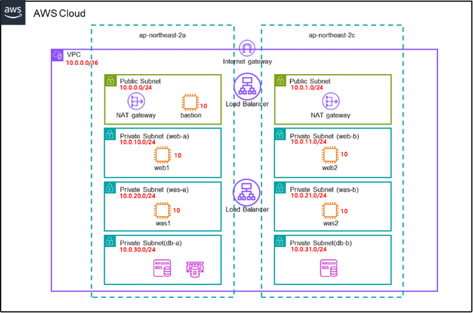

# 5.6 AWS EKS 기반 3계층(Web-WAS-DB) 구성

5.4(EC2 기반)와 같은 구성도·요청 흐름을 유지하면서 web·was 서버를 **Amazon EKS 관리형 노드 그룹**으로 바꾼다. 5.4에서 서버에 접속해 손으로 하던 애플리케이션 설치(DB 생성, Flask, NGINX)까지 쿠버네티스 리소스로 만들어 `terraform apply` 한 번에 서비스가 동작한다.



그림 5-6. 실습 구성도 (web1·web2 → web 노드 그룹, was1·was2 → was 노드 그룹)

요청 흐름은 다음과 같다. 5.4와 달라진 부분은 서버가 노드 그룹이 되고 대상 그룹이 노드의 NodePort로 보낸다는 점뿐이다.

```txt
사용자 ─ http://<web-lb DNS>
   │
   ▼
ALB web-lb (인터넷 경계, public-subnet-a/b) ── web-tg (HTTP:30080, /healthz)
   │
   ▼
web 노드 그룹 (web-subnet-a/b, web-sg) :30080 → web 파드 2개  NGINX :80 → was.cloud.local:5000
   │
   ▼
NLB was-lb (내부, was-subnet-a/b, TCP:5000) ── was-tg (TCP:30500)
   │
   ▼
was 노드 그룹 (was-subnet-a/b, was-sg) :30500 → was 파드 2개  Flask :5000
   ├──▶ db.cloud.local     → RDS MySQL :3306 (db-subnet-a 기본 / db-subnet-b 대기)
   └──▶ redis.cloud.local  → ElastiCache Redis OSS :6379 (db-subnet-a, TLS)

관리 접속: 내 PC ─SSH─▶ bastion 10.0.0.10 (public-subnet-a) ─kubectl─▶ EKS API (프라이빗 엔드포인트)
                                                          └SSH(ProxyJump)─▶ 노드
```

## 5.4와 비교

| 5.4 (EC2) | 5.6 (EKS) | 파일 |
| --- | --- | --- |
| VPC, IGW, 서브넷 8개, NAT 2개, 라우팅 | 같음 | network.tf (5.4와 동일) |
| 보안 그룹 7개 | 같은 7개. web-sg·was-sg의 서비스 포트가 80·5000 → NodePort 30080·30500 | security.tf |
| bastion (10.0.0.10) | 같음 + kubectl, 클러스터 관리자 권한(액세스 항목) | bastion.tf, iam.tf |
| web1·web2 (web-subnet-a/b) | `aws_eks_node_group.this["web"]` 노드 2대, 보안 그룹 web-sg, 레이블 `tier=web` | eks.tf |
| was1·was2 (was-subnet-a/b) | `aws_eks_node_group.this["was"]` 노드 2대, 보안 그룹 was-sg, 레이블 `tier=was` | eks.tf |
| - | EKS 클러스터 `myeks` (컨트롤 플레인 ENI는 web/was 서브넷) | eks.tf, iam.tf |
| 내부 DNS `cloud.local` | 같음 | dns.tf (5.4와 동일) |
| RDS + `db.cloud.local` | 같음 | rds.tf (5.4와 동일) |
| ElastiCache + `redis.cloud.local` | 같음 | elasticache.tf (5.4와 동일) |
| NLB was-lb + was-tg(인스턴스 was1·was2) + `was.cloud.local` | 같음. was-tg 대상은 was 노드 그룹의 ASG | was_lb.tf |
| ALB web-lb + web-tg(인스턴스 web1·web2) | 같음. web-tg 대상은 web 노드 그룹의 ASG | web_lb.tf |
| 5.4.5 3 DB·사용자·테이블 생성 (수동) | Job `db-init` | k8s_app.tf |
| 5.4.7 1~5 Flask 설치·systemd 등록 (수동) | Deployment·Service `was` (파드 2개, NodePort 30500) | k8s_app.tf |
| 5.4.8 1~2 NGINX 설치·lb.conf (수동) | Deployment·Service `web` (파드 2개, NodePort 30080) + ConfigMap `web-nginx` | k8s_app.tf |

설계 메모

- **로드 밸런서는 5.4처럼 테라폼이 만든다.** AWS Load Balancer Controller를 쓰지 않으므로 State 밖에서 생기는 리소스가 없고, `terraform destroy` 한 번으로 모두 지워진다.
- **노드에 계층 보안 그룹을 붙인다.** 시작 템플릿으로 노드에 `[클러스터 보안 그룹, web-sg | was-sg]`를 지정한다. VPC CNI는 파드 IP를 노드 ENI에 할당하므로 was 파드의 트래픽도 was-sg로 식별되어 mysql-sg·redis-sg 규칙(소스 was-sg, bastion-sg)이 5.4와 똑같이 적용된다.
- **파드도 `*.cloud.local`을 그대로 쓴다.** CoreDNS가 VPC DNS로 전달하므로 Route 53 프라이빗 호스팅 영역이 조회된다. 학습자료의 Flask 앱(mywas2)과 NGINX 설정을 고치지 않고 사용한다.
- 노드 IP는 서브넷에서 자동 할당된다(5.4의 고정 IP `.10`은 노드 그룹에서 지정할 수 없다).

## 실행

사전 준비: AWS CLI 자격 증명, 키 페어 `mykey`(5.4.2 참고). 실습 PC에 kubectl은 없어도 된다(확인용으로만 사용).

```bash
cd ch05/5.6
cp terraform.tfvars.example terraform.tfvars   # admin_cidr, db_password 수정
terraform init
terraform plan
terraform apply -auto-approve                   # 약 20~25분 (EKS 클러스터 ~10분, 노드 그룹, RDS)
terraform output
```

> `admin_cidr`는 bastion SSH와 **EKS API 퍼블릭 엔드포인트** 모두에 적용된다. 테라폼(kubernetes 프로바이더)이 실습 PC에서 클러스터에 접속해 앱을 배포하므로, 실습 PC의 공인 IP가 바뀌면 `admin_cidr`도 바꿔야 한다.

`apply`가 끝나면 서비스가 바로 동작한다. 테라폼은 Job `db-init`이 완료되고 was·web 파드가 Ready가 될 때까지 기다린다.

## 확인

```bash
# 1) 브라우저 또는 curl로 접속 → 로그인 화면 (5.4.7 3)
curl -s $(terraform output -raw web_url)/login | head
curl -s $(terraform output -raw web_url)/healthz      # OK

# 2) 대상 그룹 상태: 노드 2대씩 healthy
aws elbv2 describe-target-health --target-group-arn $(aws elbv2 describe-target-groups --names web-tg --query 'TargetGroups[0].TargetGroupArn' --output text)
aws elbv2 describe-target-health --target-group-arn $(aws elbv2 describe-target-groups --names was-tg --query 'TargetGroups[0].TargetGroupArn' --output text)

# 3) 클러스터 (실습 PC에 kubectl이 있거나 bastion에서)
$(terraform output -raw kubeconfig_command)
kubectl get nodes -L tier,topology.kubernetes.io/zone
kubectl get pods -o wide
kubectl logs job/db-init
```

브라우저에서 회원 가입(Register) → 로그인하면 대시보드에 처리한 was 파드 이름(Server Name)이 보인다. 새로 고침해도 로그인이 유지되면 Redis 세션 공유가 동작하는 것이다(5.4.10). was 파드 하나를 지워도(`kubectl delete pod <was 파드>`) 로그인이 유지된다.

bastion에서 확인 (5.4와 동일):

```bash
ssh -i ~/keys/mykey.pem ec2-user@$(terraform output -raw bastion_public_ip)
mysql -h db.cloud.local -u frodo -p -e "SELECT id, username FROM frodo.users;"
kubectl get pods -o wide        # bastion에도 kubeconfig가 설정되어 있다
```

## 삭제

로드 밸런서를 포함한 모든 리소스가 State에 있으므로 한 번에 삭제된다. 쿠버네티스 리소스가 노드 그룹보다 먼저 지워지도록 의존성을 걸어 두었다.

```bash
terraform destroy -auto-approve
```

> **비용 주의**: EKS 컨트롤 플레인, t3.medium 노드 4대, NAT 게이트웨이 2개, ALB·NLB, RDS, ElastiCache가 시간당 과금된다. 실습이 끝나면 바로 삭제한다. 비용을 줄이려면 `terraform.tfvars`에 `db_multi_az = false`를 넣는다.
